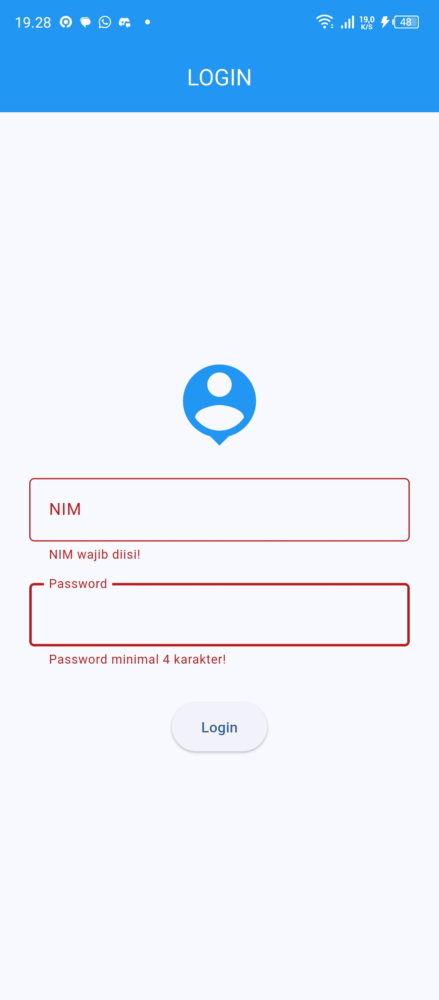
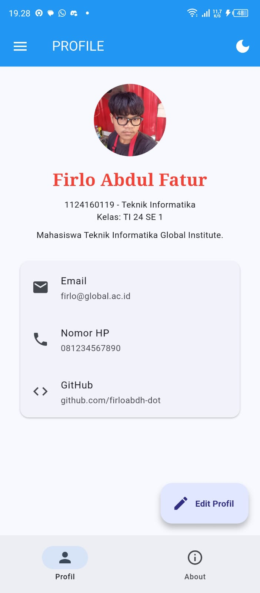
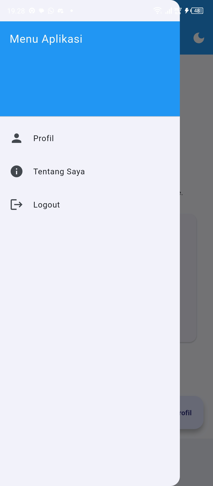
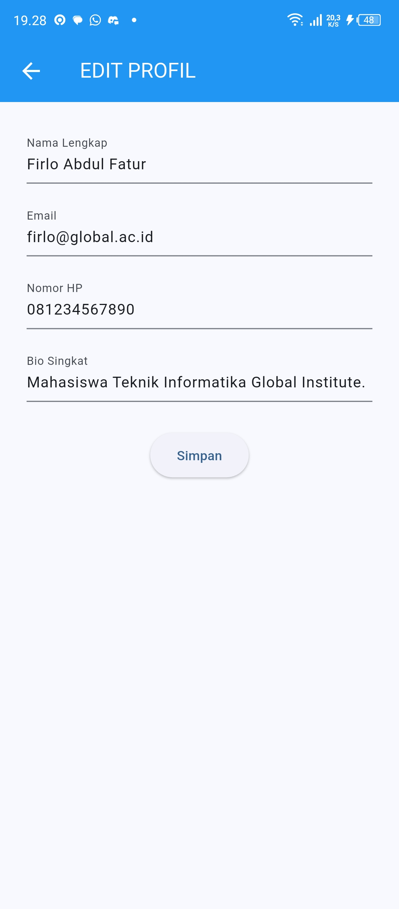
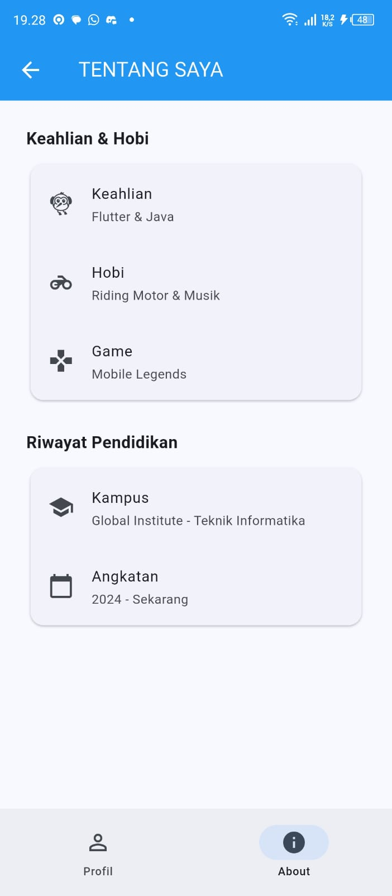

# Ujian Tengah Semester (UTS) – Pemrograman Mobile Lanjutan
Institut Teknologi & Bisnis Bina Sarana Global
Semester 5 (Ganjil) 2026/2027

## 👤 Identitas Mahasiswa
| Data | Keterangan |
| :--- | :--- |
| **Nama** | Firlo Abdul Fatur |
| **NIM** | 1124160119 |
| **Kelas** | TI 24 SE 1 |
| **Program Studi** | Teknik Informatika |
| **Repository** | uts-pml-1124160119 |

## 🎬 Link Video Presentasi YouTube
🔗 [Tonton Video Demo & Penjelasan di YouTube](#) *(Nanti ganti # dengan link videomu)*

## 📦 Unduhan APK Release
File APK telah dibuat dengan perintah `flutter build apk --release` dan diunggah ke GitHub Releases.
📥 [Download app-release.apk (v1.0.0)](#) *(Nanti ganti # dengan link rilis GitHub)*

## 📸 Screenshot Aplikasi

| 1. Halaman Login | 2. Halaman Profil (Light) | 3. Halaman Sidebar |
| :---: | :---: | :---: |
|  |  |  |

| 4. Halaman Edit Profil | 5. Halaman Tentang Saya |
| :---: | :---: |
|  |  |

## 📱 Daftar Fitur Aplikasi
1. **Halaman Login (`login_page.dart`):** Menggunakan `StatefulWidget`, terdapat validasi form, dan perpindahan navigasi menggunakan `Navigator.pushReplacementNamed`.
2. **Halaman Profil Utama (`profile_page.dart`):** Menampilkan foto profil dari assets lokal, memuat informasi identitas lengkap (Nama, NIM, Kontak), dan dilengkapi fitur *Dark Mode* interaktif.
3. **Halaman Edit Profil (`edit_profile_page.dart`):** Form lengkap dengan validasi ketat (Nama wajib diisi, Email harus mengandung `@`, dan Nomor HP harus berupa 10-13 digit angka). Menggunakan `Navigator.pop` dan `setState()` untuk memperbarui data ke layar utama.
4. **Halaman Tentang Saya (`about_page.dart`):** Memanfaatkan widget `ListView` untuk menampilkan daftar keahlian, hobi, dan riwayat pendidikan menggunakan komponen *reusable* `InfoTile`.
5. **Navigasi Lengkap & Modern:** Dilengkapi komponen navigasi menyeluruh yang mencakup `AppBar`, menu samping `Drawer`, tombol melayang `FloatingActionButton.extended`, serta menu navigasi bawah modern `NavigationBar`.

## 📂 Struktur Proyek Terpisah (Modular)
```text
lib/
├── main.dart
├── models/
│   └── profile.dart
├── screens/
│   ├── about_page.dart
│   ├── edit_profile_page.dart
│   ├── login_page.dart
│   └── profile_page.dart
└── widgets/
    └── info_tile.dart
